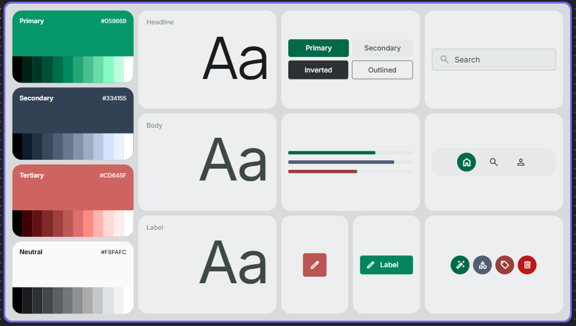

# Design System Document: The Emerald Perspective

## 1. Overview & Creative North Star

### Creative North Star: "The Clinical Oasis"
This design system is built to transform complex environmental data into a serene, authoritative, and high-end editorial experience. We reject the "standard dashboard" aesthetic of cluttered grids and heavy borders. Instead, we embrace **The Clinical Oasis**: a philosophy that prioritizes breathing room, sophisticated tonal layering, and an emerald-centric palette that feels both ecological and high-tech.

The design breaks the "template" look through intentional asymmetry in data layouts and the use of high-contrast typography scales. By using varying levels of surface depth and "floating" elements, we create a digital environment that feels physical, layered, and premium—moving beyond utility into a signature brand experience.

---

## 2. Colors: Tonal Depth & The Emerald Core

Our palette uses Emerald Green (`primary: #006948`) as the anchor of authority. The goal is to create a clean, "No-Line" interface where structure is defined by color shifts rather than structural strokes.

### The "No-Line" Rule
**Explicit Instruction:** Do not use 1px solid borders to section off areas. Sections must be defined solely by background color transitions.
* *Example:* A data visualization area using `surface-container-low` (#f2f4f6) sitting on a `background` (#f7f9fb) provides all the separation the eye needs without visual noise.

### Surface Hierarchy & Nesting
Treat the UI as a series of physical layers. Use the Material `surface-container` tiers to create "nested" depth:
* **Level 0 (Base):** `surface` (#f7f9fb)
* **Level 1 (Sections):** `surface-container-low` (#f2f4f6)
* **Level 2 (Cards):** `surface-container-lowest` (#ffffff)
* **Level 3 (Modals/Popovers):** `surface-bright` (#f7f9fb) with high elevation.

### The "Glass & Gradient" Rule
To add visual "soul," use Glassmorphism for floating headers or navigation rails. Apply a semi-transparent `surface` color with a `backdrop-blur` of 20px. For main CTAs, use a subtle linear gradient from `primary` (#006948) to `primary_container` (#00855d) to provide a rich, jewel-toned depth that flat colors lack.

---

## 3. Typography: Editorial Authority

We use a dual-font strategy to balance character with readability.

* **Display & Headlines (Manrope):** This geometric sans-serif provides a modern, slightly technical feel. Use `display-lg` (3.5rem) for hero metrics to give them an editorial presence.
* **Body & Labels (Inter):** Chosen for its exceptional legibility in data-heavy environments.

The hierarchy is designed to be high-contrast. A `headline-lg` (2rem) should feel significantly more "important" than the `body-md` (0.875rem) beneath it, creating a clear entry point for the user's eye.

---

## 4. Elevation & Depth: Tonal Layering

Traditional shadows and borders are replaced by **Tonal Layering**. Depth is achieved through the "stacking" of our surface tokens.

* **Ambient Shadows:** If an element must "float" (like a global filter fab), use an extra-diffused shadow: `box-shadow: 0 12px 32px rgba(0, 105, 72, 0.06);`. Notice the shadow is tinted with the primary emerald color to mimic natural light refraction.
* **The "Ghost Border" Fallback:** If accessibility requires a container edge, use a "Ghost Border": `outline-variant` (#bccac0) at 15% opacity. Never use 100% opaque borders.
* **Glassmorphism:** Use for persistent navigation or high-level filters. This softens the edges of the UI and makes the layout feel integrated into the environment.

---

## 5. Components

### Buttons
* **Primary:** Emerald gradient (`primary` to `primary_container`), `rounded-md` (0.75rem). No border. White text.
* **Secondary:** `surface-container-highest` (#e0e3e5) background with `on-surface-variant` text. High-end, subtle.
* **Tertiary/Ghost:** No background. `primary` text. Use for low-emphasis actions like "View Details."

### Input Fields & Controls
* **Fields:** Use `surface-container-highest` (#e0e3e5) for the input track. Instead of a box, use a bottom-weighted `outline-variant` to signify the interaction point.
* **Sliders (Environmental Gauges):** Utilize a thick `primary` track with a `primary-fixed` (#85f8c4) thumb. This high-contrast emerald-on-emerald look feels custom and branded.

### Information Cards
* **Rules:** Forbid the use of divider lines within cards. Use `spacing-6` (1.5rem) to separate the header from the data body.
* **Alert Cards:** Use `error_container` (#ffdad6) with a 20% opacity as a soft background wash for critical environmental alerts, paired with the `error` (#ba1a1a) icon.

### Data Visualization Containers
* Forgo the standard white box. Place charts directly on a `surface-container-low` background with `rounded-lg` corners. This makes the data feel "etched" into the interface.

---

## 6. Do's and Don'ts

### Do:
* **Embrace White Space:** Use the Spacing Scale aggressively. If in doubt, increase the margin.
* **Use Intentional Asymmetry:** Align metrics to a 12-column grid but allow for varied card widths to create visual interest.
* **Layer Surfaces:** Use `surface-container-lowest` white cards on a `surface-container-low` greyish-blue background for maximum "pop" without shadows.

### Don't:
* **Don't Use Pure Black:** Always use `on-surface` (#191c1e) for text to maintain the soft, premium feel.
* **Don't Use Grid Lines:** Avoid table borders or chart grid lines where possible. Let the data's alignment create the structure.
* **Don't Use Default Roundedness:** Stick strictly to the `rounded-md` (0.75rem) for cards and `rounded-full` for chips to maintain the system's signature "soft-modern" look.